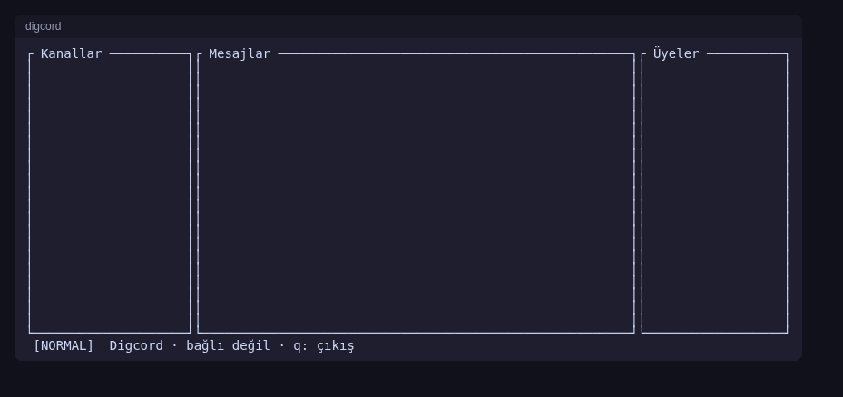

# Digcord

> Discord için tamamen Rust ile yazılmış, hızlı ve hafif bir terminal (TUI) istemcisi.



## Durum

**Erken aşama (Aşama 0 — İskelet, v0.1.0).** Şu an çalışan kısım: Cargo workspace, ratatui ile boş üç panelli arayüz
(Kanallar | Mesajlar | Üyeler + durum çubuğu), `q` / `Ctrl+C` ile çıkış, panic'te terminalin geri yüklenmesi,
dosyaya loglama (token maskeleme) ve CI. Gateway, REST, giriş ve mesajlaşma **henüz yazılmadı**;
`digcord-*` crate'lerinin çoğu boş. Aşamalar ve kabul kriterleri: [`docs/ROADMAP.md`](docs/ROADMAP.md).

## Hedeflenen özellikler

- Sunucular, kanallar, thread'ler; mesaj okuma / yazma / düzenleme / silme / yanıt / tepki
- DM, grup DM, arkadaş listesi, okunmamış sayaçları, masaüstü bildirimleri
- Terminalde resim, emoji ve sticker (Kitty / Sixel / iTerm2 / yarım blok yedeği)
- Sesli kanallar (DAVE uçtan uca şifreleme)
- Gateway ve REST katmanı `twilight` / `serenity` kullanılmadan sıfırdan

## Derleme ve çalıştırma

Rust stable (1.88+, edition 2024) gerekir.

```bash
cargo run --release    # boş arayüzü açar, q ile çık
cargo test --workspace
```

Log dosyası: `~/.local/state/digcord/digcord.log`

## ⚠️ Uyarı

Digcord **kullanıcı token'ı** ile çalışacak şekilde tasarlanmıştır. Kullanıcı hesabıyla üçüncü taraf istemci kullanmak
Discord Hizmet Koşulları'na aykırıdır ve **hesabın kapatılmasına** yol açabilir. Geliştirme ve testleri yan hesapta yap.
Spam, self-bot ve toplu işlem özellikleri bilinçli olarak eklenmeyecek.

## Teknoloji

Rust, tokio, ratatui + crossterm, ratatui-image, tokio-tungstenite + rustls, serde, keyring, notify-rust,
cpal + opus + openmls (ses/DAVE), tracing. Ayrıntı: [`docs/ARCHITECTURE.md`](docs/ARCHITECTURE.md)

Birincil platform Linux (Kitty, WezTerm, Konsole, foot, Alacritty); macOS ve Windows sonra.

## Dokümanlar

[`ARCHITECTURE`](docs/ARCHITECTURE.md) · [`PROTOCOL_NOTES`](docs/PROTOCOL_NOTES.md) · [`TUI_DESIGN`](docs/TUI_DESIGN.md) · [`ROADMAP`](docs/ROADMAP.md) · [`GIT_WORKFLOW`](docs/GIT_WORKFLOW.md) · [`CLAUDE.md`](CLAUDE.md)

## Lisans

**Tescilli — Tüm hakları saklıdır.** Kod açık kaynak değildir; ayrıntılar: [`LICENSE`](LICENSE)
